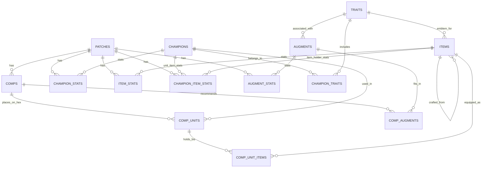

# Kiến trúc hệ thống, Nghiệp vụ & Thiết kế Database (TFT Hub)

> Tài liệu này là **Single Source of Truth** về nghiệp vụ, kiến trúc, database ERD và hợp đồng API `v1` cho dự án **TFT Hub**. Mọi thay đổi schema hoặc endpoint phải cập nhật lại tài liệu này để đồng bộ giữa Backend (`tft-hub`) và Frontend (`tft-hub-web`).

---

## 1. Tổng quan nghiệp vụ: Kết hợp TFT Academy + tactics.tools

Dự án kết hợp trực tiếp thế mạnh của hai nền tảng TFT hàng đầu:
- **Từ TFT Academy**: Giao diện trực quan theo phân bậc `S / A / B / C TIER`, hướng dẫn lối chơi (*Khi nào nên chơi*, *Bài giữ máu*, *Ưu tiên đi chợ*), bàn cờ lục giác 4×7, Tooltip hiển thị công thức ghép + `Recommended Holders`, quản trị meta kiểu chuyên gia (Curated).
- **Từ tactics.tools**: Bảng thống kê sort đa cột (`Play Rate`, `Place / AVP`, `Delta`, `Top 4 %`, `Win %`, `3★ Rate`, `3★ Place`), phân bố hạng 1–8 (`Placement Distribution`), bộ lọc theo `Patch`, `Rank`, `Star Level`, và trang/modal chi tiết chuyên sâu.

### 4 Module thống nhất (bao phủ toàn bộ 6 yêu cầu ban đầu)

| Module / Route | Cảm hứng | View Modes | Nghiệp vụ & Liên kết chéo |
|---|---|---|---|
| **`/comps`** — Đội hình Meta | TFT Academy + stats tactics.tools | `TIER LIST` (`S/A/B/C`) + trang chi tiết `/comps/:slug` | Hiển thị đội hình meta, playstyle (`Fast 8`, `Slow Roll`...), bàn cờ 4×7 theo từng giai đoạn (`EARLY / MID / LATE`), 3 đồ chuẩn carry, lõi khuyên dùng. Click tướng -> `/units/:id`; click đồ -> `/items/:id`; click lõi -> `/augments`. |
| **`/units`** — Tướng & Đồ theo Tướng | `tactics.tools/units` + Comps | `GRID` (gom theo Cost 1–5) \| `LIST` (bảng stats có `3★ Rate`, `3★ Place`) + **Unit Detail Modal/Page** | Bổ sung bộ lọc `Search`, `Cost`, `Tộc/Hệ`. Trong Unit Detail có bộ lọc `Star Level (Any / 1★ / 2★ / 3★)`, `Star Distribution`, `Placement Distribution (1–8)`, tab **Tier list đồ theo tướng** (lọc `All / Craftables / Emblems / Artifacts`, sort theo **Delta**) và tab **Đội hình mạnh đi kèm**. |
| **`/items`** — Đồ ghép / Ấn / Đồ Ornn / Ánh sáng | **Kết hợp** `tftacademy/tierlist/items` + `tactics.tools/items` | `TIER VIEW` (`S/A/B/C`) \| `STATS TABLE` + **Item Detail** (`/items/:apiName`) | 5 tab nhóm đồ: `Craftables`, `Artifacts (Đồ Ornn)`, `Emblems (Ấn)`, `Radiants (Ánh sáng)`, `Tất cả`. Riêng tab `Emblems` lọc được `Ấn ghép được (Xẻng/Chảo)` vs `Ấn không ghép được`. Item Detail có `Placement Distribution (1–8)` + 3 sub-tab: `Units (Delta)`, `Comps (Đội hình đi kèm)`, `Paired Items`. |
| **`/augments`** — Lõi Nâng Cấp | **Kết hợp** cả 2 | `TIER VIEW` \| `STATS TABLE` | Lọc theo bậc `SILVER / GOLD / PRISMATIC`, nhóm (`Combat / Econ / Trait / Item`), và theo vòng (`Tổng quan / 2-1 / 3-2 / 4-2`). Mỗi lõi hiển thị trực tiếp danh sách **Đội hình mạnh đi kèm** -> click sang `/comps/:slug`. |

---

## 2. Ba quyết định nghiệp vụ đã chốt (Optimal Strategy)

1. **Cách tính Tier (`S / A / B / C`) — Hybrid Tier**:
   - Đội hình (`comps`): **Curated** — Admin tự xếp hạng `S / A / B / C` và `tier_rank` như TFT Academy.
   - Tướng, Trang bị, Ấn, Đồ Ornn, Lõi nâng cấp: Dùng `COALESCE(curated_tier, calculated_tier)`. Hệ thống tự động tính `calculated_tier` dựa trên `AVP` / `Delta` khi có dữ liệu patch mới, nhưng Admin vẫn có quyền override bằng `curated_tier` nếu muốn đánh giá theo meta chuyên gia.
2. **Phạm vi dữ liệu thống kê — Schema mở rộng sẵn, Code làm theo 2 tầng**:
   - Schema PostgreSQL thiết kế sẵn cột `set_number`, `rank_tier`, `star_level`, `board_phase`, `placement_distribution`, `star_distribution` ngay từ Tuần 1 để không phải đập đi sửa lại DB về sau.
   - **Tầng MVP (Phase 1–3)**: Triển khai đầy đủ Single-Item Stats (`Place`, `Delta`, `Top 4%`, `Win%`, `Play Rate`), `3★ Rate / 3★ Place`, `Placement Distribution (1–8)`, lọc `Star Level`, và liên kết chéo với `Comps`.
   - **Tầng Mở rộng (Phase 5)**: Thêm `Item Pairs / Trios`, biểu đồ `Trends`, đa bậc `Rank (Diamond+ / Master+ / GM+)` bằng dữ liệu thật từ Riot Games TFT API.
3. **Ngôn ngữ dữ liệu — Song ngữ `VI + EN` ngay từ đầu**:
   - Pipeline sync đọc đồng thời `vi_vn.json` và `en_us.json` từ CommunityDragon theo cùng khóa `api_name`.
   - Giao diện hỗ trợ chuyển `VI | EN`, ô tìm kiếm khớp đồng thời cả `name_vi` và `name_en` (gõ *"Cuồng Đao"* hay *"Guinsoo"* đều ra).

---

## 3. Quyết định Kiến trúc phần mềm

### Chọn **Modular Monolith** thay vì Microservices
- **Lý do**: Dữ liệu TFT có mức độ liên kết chéo rất cao (1 tướng gắn với nhiều đồ chuẩn và nhiều đội hình; 1 ấn nối tới tộc/hệ, tướng cầm và đội hình; 1 lõi nối với nhiều đội hình). Nếu tách Microservices với DB riêng sẽ phát sinh join phân tán phức tạp, độ trễ mạng lớn và quá tải vận hành cho quy mô Intern/Solo project.
- **Tách riêng 2 Repo Git**:
  - `tft-hub/` (`https://github.com/vulinhduc2506/tft-hub`): Backend Spring Boot 4.1.2 (Java 17).
  - `tft-hub-web/` (tạo ở Phase 3): Frontend Angular (Standalone Components, Signals, Tailwind CSS).

### Cấu trúc package Backend (`com.ducvl.tft_hub`)
```text
src/main/java/com/ducvl/tft_hub/
├── common/      # GlobalExceptionHandler (ProblemDetail RFC 7807), CorsConfig, TierCalculator, shared DTO
├── patch/       # Quản lý Patch & Set hiện hành
├── catalog/     # Static metadata: Trait, Champion, Item, Augment
├── comp/        # Đội hình Meta (TFT Academy): Comp, CompUnit (Hex 4x7), CompUnitItem, CompAugment
├── stats/       # Thống kê (tactics.tools): ChampionStats, ItemStats, ChampionItemStats, AugmentStats
├── sync/        # CommunityDragonSyncService (+ RiotApiCrawler ở Phase 5)
└── admin/       # Spring Security JWT + CRUD CMS (Phase 4)
```

---

## 4. Thiết kế Database (ERD & Flyway Schema)



### Nhóm 1: Static Metadata (`V1__init_static_schema.sql`)
- **`patches`**: `id BIGSERIAL PK`, `code VARCHAR(20) UNIQUE NOT NULL` (vd `18.7`), `set_number INT NOT NULL`, `set_name VARCHAR(100)`, `is_current BOOLEAN NOT NULL DEFAULT FALSE`, `released_at TIMESTAMPTZ`, `updated_at TIMESTAMPTZ NOT NULL DEFAULT NOW()`.
- **`traits`**: `id BIGSERIAL PK`, `set_number INT NOT NULL`, `api_name VARCHAR(100) NOT NULL`, `name_vi VARCHAR(120) NOT NULL`, `name_en VARCHAR(120) NOT NULL`, `description_vi TEXT`, `description_en TEXT`, `icon_url VARCHAR(500)`, `breakpoints JSONB NOT NULL DEFAULT '[]'::jsonb`.
  - `UNIQUE (set_number, api_name)`
- **`champions`**: `id BIGSERIAL PK`, `set_number INT NOT NULL`, `api_name VARCHAR(100) NOT NULL`, `name_vi VARCHAR(120) NOT NULL`, `name_en VARCHAR(120) NOT NULL`, `cost SMALLINT NOT NULL`, `role VARCHAR(50)`, `icon_url VARCHAR(500)`, `tile_url VARCHAR(500)`.
  - `UNIQUE (set_number, api_name)`, `INDEX idx_champions_set_cost (set_number, cost)`
- **`champion_traits`**: `champion_id BIGINT FK -> champions(id) ON DELETE CASCADE`, `trait_id BIGINT FK -> traits(id) ON DELETE CASCADE`, `PRIMARY KEY (champion_id, trait_id)`.
- **`items`**: `id BIGSERIAL PK`, `set_number INT NOT NULL`, `api_name VARCHAR(100) NOT NULL`, `name_vi VARCHAR(150) NOT NULL`, `name_en VARCHAR(150) NOT NULL`, `category VARCHAR(30) NOT NULL` (`COMPONENT | CRAFTABLE | EMBLEM | ARTIFACT | RADIANT | SUPPORT | OTHER`), `is_craftable_emblem BOOLEAN NOT NULL DEFAULT FALSE`, `component_1_id BIGINT FK -> items(id)`, `component_2_id BIGINT FK -> items(id)`, `emblem_trait_id BIGINT FK -> traits(id)`, `base_stats JSONB NOT NULL DEFAULT '{}'::jsonb`, `description_vi TEXT`, `description_en TEXT`, `icon_url VARCHAR(500)`.
  - `UNIQUE (set_number, api_name)`, `INDEX idx_items_set_category (set_number, category)`
- **`augments`**: `id BIGSERIAL PK`, `set_number INT NOT NULL`, `api_name VARCHAR(120) NOT NULL`, `name_vi VARCHAR(150) NOT NULL`, `name_en VARCHAR(150) NOT NULL`, `augment_tier VARCHAR(20) NOT NULL` (`SILVER | GOLD | PRISMATIC`), `category VARCHAR(30)` (`COMBAT | ECON | TRAIT | ITEM | HERO`), `associated_trait_id BIGINT FK -> traits(id)`, `description_vi TEXT`, `description_en TEXT`, `icon_url VARCHAR(500)`.
  - `UNIQUE (set_number, api_name)`, `INDEX idx_augments_set_tier (set_number, augment_tier)`

### Nhóm 2: Đội hình Meta — TFT Academy (`V2__init_meta_and_stats_schema.sql`)
- **`comps`**: `id BIGSERIAL PK`, `patch_id BIGINT NOT NULL FK -> patches(id) ON DELETE CASCADE`, `slug VARCHAR(120) NOT NULL`, `name_vi VARCHAR(150) NOT NULL`, `name_en VARCHAR(150) NOT NULL`, `tier CHAR(1) NOT NULL` (`S | A | B | C`), `tier_rank INT NOT NULL DEFAULT 100`, `playstyle VARCHAR(30) NOT NULL` (`FAST_8 | FAST_9 | SLOW_ROLL | HYPER_ROLL | STANDARD`), `difficulty VARCHAR(20) NOT NULL DEFAULT 'MEDIUM'`, `when_to_play_vi TEXT`, `when_to_play_en TEXT`, `early_game_notes_vi TEXT`, `early_game_notes_en TEXT`, `tips_vi TEXT`, `tips_en TEXT`, `carousel_priority JSONB NOT NULL DEFAULT '[]'::jsonb`, `avg_placement NUMERIC(4,2)`, `top4_rate NUMERIC(5,2)`, `win_rate NUMERIC(5,2)`, `play_rate NUMERIC(5,2)`, `is_published BOOLEAN NOT NULL DEFAULT TRUE`, `updated_at TIMESTAMPTZ NOT NULL DEFAULT NOW()`.
  - `UNIQUE (patch_id, slug)`, `INDEX idx_comps_patch_tier (patch_id, tier, tier_rank)`
- **`comp_units`**: `id BIGSERIAL PK`, `comp_id BIGINT NOT NULL FK -> comps(id) ON DELETE CASCADE`, `champion_id BIGINT NOT NULL FK -> champions(id)`, `board_phase VARCHAR(10) NOT NULL DEFAULT 'LATE'` (`EARLY | MID | LATE`), `hex_row SMALLINT NOT NULL` (0–3), `hex_col SMALLINT NOT NULL` (0–6), `star_level SMALLINT NOT NULL DEFAULT 2` (1–3), `is_carry BOOLEAN NOT NULL DEFAULT FALSE`, `is_core BOOLEAN NOT NULL DEFAULT TRUE`.
  - `UNIQUE (comp_id, board_phase, hex_row, hex_col)`, `INDEX idx_comp_units_champ (champion_id)`
- **`comp_unit_items`**: `comp_unit_id BIGINT NOT NULL FK -> comp_units(id) ON DELETE CASCADE`, `slot_order SMALLINT NOT NULL` (1–3), `item_id BIGINT NOT NULL FK -> items(id)`, `PRIMARY KEY (comp_unit_id, slot_order)`.
- **`comp_augments`**: `comp_id BIGINT NOT NULL FK -> comps(id) ON DELETE CASCADE`, `augment_id BIGINT NOT NULL FK -> augments(id)`, `priority VARCHAR(20) NOT NULL DEFAULT 'RECOMMENDED'` (`BIS | RECOMMENDED | SITUATIONAL`), `PRIMARY KEY (comp_id, augment_id)`.

### Nhóm 3: Thống kê theo Patch — tactics.tools (`V2__init_meta_and_stats_schema.sql`)
- **`champion_stats`**: `id BIGSERIAL PK`, `patch_id BIGINT NOT NULL FK -> patches(id) ON DELETE CASCADE`, `rank_tier VARCHAR(20) NOT NULL DEFAULT 'DIAMOND_PLUS'`, `champion_id BIGINT NOT NULL FK -> champions(id)`, `star_level SMALLINT NOT NULL DEFAULT 0` (`0=Any, 1, 2, 3`), `calculated_tier CHAR(1)`, `curated_tier CHAR(1)`, `games_count INT NOT NULL DEFAULT 0`, `play_rate NUMERIC(5,2) NOT NULL`, `avg_placement NUMERIC(4,2) NOT NULL`, `top4_rate NUMERIC(5,2) NOT NULL`, `win_rate NUMERIC(5,2) NOT NULL`, `three_star_rate NUMERIC(5,2)`, `three_star_avg_placement NUMERIC(4,2)`, `placement_distribution JSONB NOT NULL DEFAULT '[]'::jsonb`, `star_distribution JSONB NOT NULL DEFAULT '{}'::jsonb`.
  - `UNIQUE (patch_id, rank_tier, champion_id, star_level)`, `INDEX idx_champ_stats_lookup (patch_id, rank_tier, star_level, avg_placement)`
- **`item_stats`**: `id BIGSERIAL PK`, `patch_id BIGINT NOT NULL FK -> patches(id) ON DELETE CASCADE`, `rank_tier VARCHAR(20) NOT NULL DEFAULT 'DIAMOND_PLUS'`, `item_id BIGINT NOT NULL FK -> items(id)`, `calculated_tier CHAR(1)`, `curated_tier CHAR(1)`, `games_count INT NOT NULL DEFAULT 0`, `play_rate NUMERIC(5,2) NOT NULL`, `avg_placement NUMERIC(4,2) NOT NULL`, `delta NUMERIC(4,2)`, `top4_rate NUMERIC(5,2) NOT NULL`, `win_rate NUMERIC(5,2) NOT NULL`, `placement_distribution JSONB NOT NULL DEFAULT '[]'::jsonb`.
  - `UNIQUE (patch_id, rank_tier, item_id)`, `INDEX idx_item_stats_lookup (patch_id, rank_tier, avg_placement)`
- **`champion_item_stats`** *(bảng 2 chiều phục vụ cả Đồ theo Tướng lẫn Top Holders của Đồ/Ấn/Ornn)*: `id BIGSERIAL PK`, `patch_id BIGINT NOT NULL FK -> patches(id) ON DELETE CASCADE`, `rank_tier VARCHAR(20) NOT NULL DEFAULT 'DIAMOND_PLUS'`, `champion_id BIGINT NOT NULL FK -> champions(id)`, `item_id BIGINT NOT NULL FK -> items(id)`, `star_level SMALLINT NOT NULL DEFAULT 0`, `calculated_tier CHAR(1)`, `curated_tier CHAR(1)`, `is_recommended_holder BOOLEAN NOT NULL DEFAULT FALSE`, `games_count INT NOT NULL DEFAULT 0`, `play_rate NUMERIC(5,2) NOT NULL`, `avg_placement NUMERIC(4,2) NOT NULL`, `delta NUMERIC(4,2) NOT NULL`, `top4_rate NUMERIC(5,2) NOT NULL`, `win_rate NUMERIC(5,2) NOT NULL`.
  - `UNIQUE (patch_id, rank_tier, champion_id, item_id, star_level)`
  - `INDEX idx_cis_by_champ (patch_id, rank_tier, champion_id, star_level, delta)`
  - `INDEX idx_cis_by_item (patch_id, rank_tier, item_id, star_level, delta)`
- **`augment_stats`**: `id BIGSERIAL PK`, `patch_id BIGINT NOT NULL FK -> patches(id) ON DELETE CASCADE`, `rank_tier VARCHAR(20) NOT NULL DEFAULT 'DIAMOND_PLUS'`, `augment_id BIGINT NOT NULL FK -> augments(id)`, `calculated_tier CHAR(1)`, `curated_tier CHAR(1)`, `games_count INT NOT NULL DEFAULT 0`, `play_rate NUMERIC(5,2) NOT NULL`, `avg_placement NUMERIC(4,2) NOT NULL`, `avg_stage_2_1 NUMERIC(4,2)`, `avg_stage_3_2 NUMERIC(4,2)`, `avg_stage_4_2 NUMERIC(4,2)`, `top4_rate NUMERIC(5,2) NOT NULL`, `win_rate NUMERIC(5,2) NOT NULL`.
  - `UNIQUE (patch_id, rank_tier, augment_id)`, `INDEX idx_aug_stats_lookup (patch_id, rank_tier, avg_placement)`

---

## 5. Hợp đồng REST API (`v1`)

Mọi endpoint công khai đều nhận optional query `patch` (mặc định lấy `is_current = true`) và `rank` (mặc định `DIAMOND_PLUS`). Lỗi trả chuẩn **RFC 7807 `ProblemDetail`**.

### A. Metadata dùng chung
- `GET /api/v1/patches` — Danh sách patch và patch đang active.
- `GET /api/v1/traits?set={setNumber}` — Danh sách tộc/hệ cho dropdown lọc.

### B. Module Đội Hình (`/comps`)
- `GET /api/v1/comps?patch=&tier=&playstyle=&trait=&champion=&search=&sort=tier|avgPlacement`
- `GET /api/v1/comps/{slug}?patch=`

### C. Module Tướng & Đồ theo Tướng (`/units`)
- `GET /api/v1/units?patch=&rank=&cost=&trait=&tier=&search=&sort=playRate,desc` *(trả về kèm `topItems` tối đa 3 đồ và `bestComps` tối đa 3 bài)*
- `GET /api/v1/units/{apiName}?patch=&rank=&starLevel=0` *(chi tiết tướng + `starDistribution` + `placementDistribution` + full `bestComps`)*
- `GET /api/v1/units/{apiName}/items?patch=&rank=&starLevel=0&category=ALL|CRAFTABLE|EMBLEM|ARTIFACT|RADIANT&sort=delta,asc`

### D. Module Trang bị / Ấn / Đồ Ornn / Ánh sáng (`/items`)
- `GET /api/v1/items?patch=&rank=&category=CRAFTABLE|EMBLEM|ARTIFACT|RADIANT|ALL&craftableEmblem=&tier=&search=&sort=playRate,desc` *(trả về kèm `effectiveTier`, công thức 2 mảnh, `emblemTrait`, `topHolders`, `bestComps`)*
- `GET /api/v1/items/{apiName}?patch=&rank=` *(chi tiết món đồ + `placementDistribution` + `bestComps`)*
- `GET /api/v1/items/{apiName}/holders?patch=&rank=&sort=delta,asc` *(danh sách tướng cầm tốt nhất kèm `delta`)*

### E. Module Lõi Nâng Cấp (`/augments`)
- `GET /api/v1/augments?patch=&rank=&augmentTier=SILVER|GOLD|PRISMATIC|ALL&category=&stage=ALL|2-1|3-2|4-2&tier=&search=&sort=avgPlacement,asc` *(trả về kèm `effectiveTier`, AVP theo từng vòng và `bestComps`)*

### F. Admin CMS (Phase 4 — Bảo vệ bằng JWT `ROLE_ADMIN`)
- `POST /api/v1/admin/auth/login`
- `POST /api/v1/admin/sync/cdragon?set={setNumber}`
- `POST / PUT / DELETE /api/v1/admin/comps`
- `PATCH /api/v1/admin/curated-tiers`
